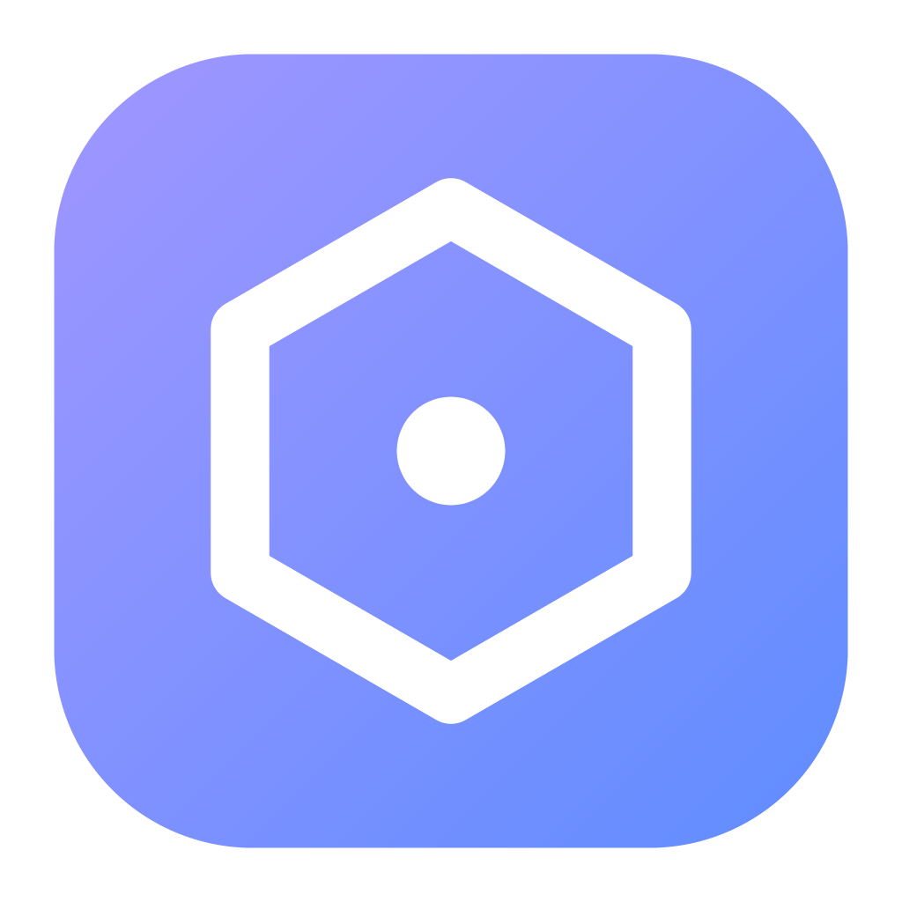

<p align="center">
  
</p>

<h1 align="center">AppForge Studio</h1>

<p align="center">
  <b>L’atelier IA de bureau pour créer, tester, héberger et déployer des apps mobiles complètes — en une demande.</b><br/>
  Expo · Backend + base de données · Déploiement intégré · N’importe quel modèle IA (Claude, OpenAI, Ollama, LM Studio…)
</p>

<p align="center">
  
  
  
  
</p>

> **English summary** — AppForge Studio is an open-source desktop coding agent (think Claude Code with an IDE) specialised in
> **Expo mobile apps + backend + database**. Describe your app; the agent scaffolds a clean architecture, writes the code,
> type-checks, runs the API and Expo, tests the endpoints, then deploys (EAS, OTA, Fly.io, Railway, VPS, Vercel) without
> leaving the window. Works with Claude, OpenAI, any OpenAI-compatible API, or fully local models via Ollama / LM Studio.
> The UI is currently in French; contributions for i18n are welcome.

---

## Fonctionnalités

- **Agent autonome « one-shot »** : plan, code, vérification (TypeScript, bundling Expo, tests HTTP des endpoints), corrections et commits git, sans interruption. Reprise automatique après coupure réseau, réponse tronquée ou contexte trop long.
- **Architecture pro générée** : `mobile/` (Expo Router, TypeScript, client API typé, EAS) et `api/` (Hono → services → Drizzle ORM, auth JWT, validation zod, Dockerfile), SQLite en local et Turso/libSQL en production.
- **IDE complet** : éditeur de code (CodeMirror), terminal (xterm), explorateur, palette de commandes (`Ctrl+K`), panneaux redimensionnables, thèmes sombre et clair.
- **Aperçu** : QR code Expo Go pour tester sur téléphone, aperçu web dans un cadre d’appareil.
- **Hébergement et déploiement en un clic** : APK Android / iOS via EAS, mises à jour OTA, backend sur Fly.io, Railway ou VPS (SSH + Docker), base Turso, version web sur Vercel, tunnel public.
- **Toute IA** : Claude (SDK officiel, thinking adaptatif), OpenAI, OpenRouter / Groq / DeepSeek / Mistral / Gemini, et modèles locaux (Ollama, LM Studio, détectés automatiquement). Mode « outils par prompt » pour les modèles sans function calling.
- **Points de restauration** : avant chaque message, le projet est photographié (même hors Git). « Revenir ici » remet le code et la conversation dans leur état d’alors ; chaque message liste les fichiers que l’agent a modifiés.
- **Conversations multiples** par projet : titre automatique, renommage, reprise après redémarrage (`Ctrl+Shift+N` pour en ouvrir une).
- **Images et maquettes** : collez (`Ctrl+V`), glissez ou joignez une capture ; l’agent reproduit l’écran. Les grandes images sont réduites automatiquement.
- **Mode Plan** (`Maj+Tab`) : l’agent explore en lecture seule et propose un plan ; un clic sur « Exécuter le plan » lance l’implémentation.
- **Suivi des coûts** : tokens (cache compris) et coût estimé par conversation pour les modèles Claude ; gratuit pour les modèles locaux.
- **Mémoire de projet**, revue des modifications git, palette d’actions agent.
- **Sécurité** : clés et secrets chiffrés par le coffre du système (DPAPI / Keychain), jamais envoyés au modèle ; garde-fous contre les commandes destructrices ; écriture confinée au dossier du projet ; trois niveaux d’autonomie (Autopilot, valider les commandes, tout valider).

## Installation

### Installable

Téléchargez la dernière version dans l’onglet **Releases** du dépôt :

| Système | Fichier |
|---|---|
| Windows 10/11 (x64) | `appforge-studio-x.y.z-win-x64-setup.exe` |
| macOS | `.dmg` |
| Linux | `.AppImage` |

> Les builds ne sont pas encore signés : Windows SmartScreen peut afficher un avertissement (« Informations complémentaires » → « Exécuter quand même »).

### Prérequis pour générer des apps

- [Node.js](https://nodejs.org) 20 ou plus récent et [Git](https://git-scm.com)
- [Expo Go](https://expo.dev/go) sur votre téléphone (même réseau Wi-Fi que le PC)
- Optionnel : Docker, Java/Android SDK (builds locaux), CLI de vos hébergeurs

## Démarrage rapide

1. **Réglages → Fournisseurs IA** : ajoutez une clé (Claude, OpenAI…) ou lancez Ollama / LM Studio (détectés automatiquement).
2. **Nouvelle app** (`Ctrl+N`) : décrivez l’application et laissez l’agent travailler.
3. **Aperçu** : scannez le QR code avec Expo Go.
4. **Déployer** : choisissez une cible ; ajoutez les jetons demandés dans **Réglages → Secrets** (`EXPO_TOKEN`, `FLY_API_TOKEN`, …).

### Modèles locaux

Pour un travail agentique fiable, choisissez un modèle de code d’au moins 14 milliards de paramètres qui gère les outils (ex. *Qwen2.5-Coder 14B/32B*), avec un contexte d’au moins 32k tokens, et de préférence sur GPU. Sur CPU seul, un modèle de cette taille est très lent (plusieurs minutes par réponse) : un fournisseur cloud reste alors préférable pour créer une app complète.

- **Ollama** : `ollama pull qwen2.5-coder:14b`, et `OLLAMA_CONTEXT_LENGTH=32768` pour agrandir le contexte.
- **LM Studio** : onglet *Developer* → *Start server* (port détecté automatiquement).

## Développement

```bash
git clone <url-du-depot>
cd appforge-studio
npm install
npm run dev          # application avec rechargement à chaud
npm test             # tests de bout en bout du moteur agent (faux modèle, vrais outils)
npm run typecheck    # TypeScript strict (main + interface + tests)
npm run dist:win     # installable Windows → dist/
```

> npm 11+ bloque les scripts d’installation par défaut : si Electron ne démarre pas après `npm install`, lancez `node node_modules/electron/install.js`.

### Architecture

```
src/
├─ shared/            types et canaux IPC partagés
├─ main/              process Electron (Node)
│  ├─ ai/             adaptateurs LLM : anthropic.ts, openaiCompat.ts, registry.ts
│  ├─ agent/          boucle agent, prompt système, garde-fous, cibles de déploiement
│  │  ├─ tools/       fichiers, patchs, shell, processus, HTTP, mémoire, scaffold
│  │  └─ templates/   backend Hono + Drizzle + JWT, compléments Expo
│  ├─ services/       réglages chiffrés, projets, fichiers, git, mémoire, processus, détection locale
│  └─ ipc.ts          pont main ↔ interface
├─ preload/           API sécurisée exposée à l’interface (contextIsolation)
└─ renderer/          interface React : agent, éditeur, terminal, aperçu, palette, réglages
tests/                tests de bout en bout du moteur agent
scripts/              outils de build (génération de l’icône…)
```

**Ajouter un fournisseur IA** : implémentez `LLMClient` (`src/main/ai/types.ts`) puis déclarez-le dans `src/main/ai/registry.ts`.
**Ajouter un outil à l’agent** : créez un `AgentTool` dans `src/main/agent/tools/` et ajoutez-le au registre `tools/index.ts`.
**Ajouter une cible de déploiement** : ajoutez une entrée dans `src/main/agent/deployTargets.ts`.

## Contribuer

Les contributions sont bienvenues ! Lisez [CONTRIBUTING.md](CONTRIBUTING.md). Pour signaler une faille, voyez [SECURITY.md](SECURITY.md).

## Licence

[MIT](LICENSE)
